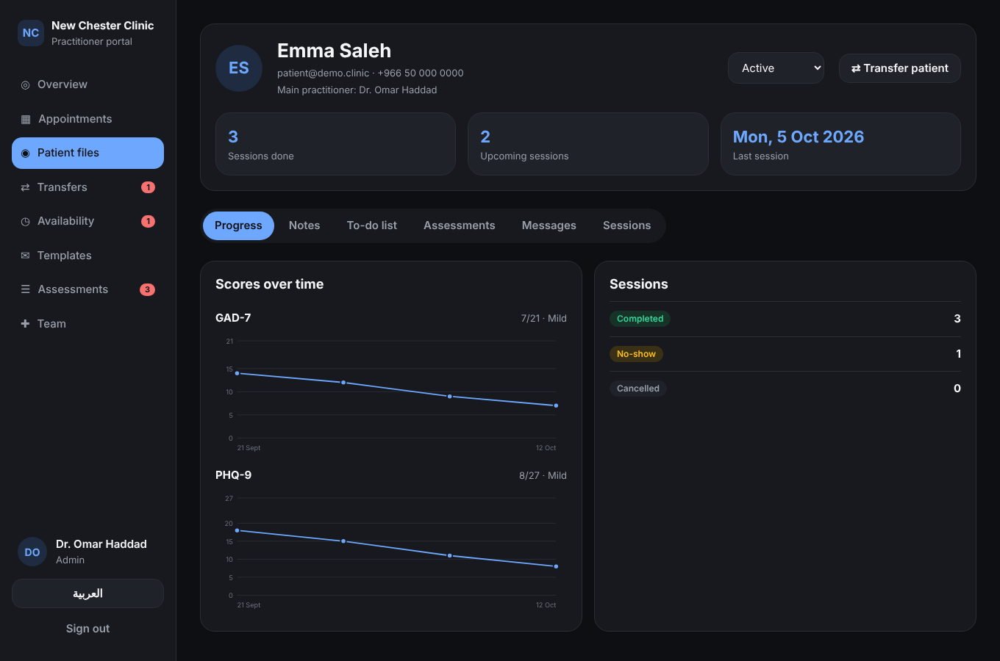

# New Chester Clinic

Online psychiatry and psychology clinic: a patient app (Expo) and a bilingual practitioner dashboard (Next.js) on Firebase.

See [docs/PLAN.md](docs/PLAN.md) for the full plan, data model and open decisions.

| | |
|---|---|
|  |  |

## Layout

```
apps/patient      Expo app for patients (iOS, Android, web)
apps/dashboard    Next.js practitioner dashboard (English / Arabic)
packages/shared   Types, theme, slot calculation, questionnaire scoring
functions         Cloud Functions (booking, transfers, scoring, roles)
firebase          Security rules, indexes, firebase.json, rules tests
```

## Run it locally on demo data

Requires Node 22 and Java (for the Firestore emulator).

```bash
npm install
npm run build -w functions
npm run emulators                 # terminal 1: auth, Firestore and functions emulators
npm run demo -w functions         # terminal 2: loads demo patients and practitioners

# Dashboard: http://localhost:3000
cp apps/dashboard/.env.emulator apps/dashboard/.env.local
npm run dashboard

# Patient app (press w for web, or scan the QR code with Expo Go)
cp apps/patient/.env.emulator apps/patient/.env.local
npm run patient
```

Demo sign-ins, all with password `demo-password`: `admin@demo.clinic` (admin and psychiatrist), `layla@demo.clinic` (psychologist), `patient@demo.clinic` (patient).

## Checks

```bash
npm run typecheck     # all packages
npm run test:rules    # Firestore security rules on the emulator
```

## Deploying

No Firebase project is connected yet. Follow "Setting up the real Firebase project" in [docs/PLAN.md](docs/PLAN.md).
