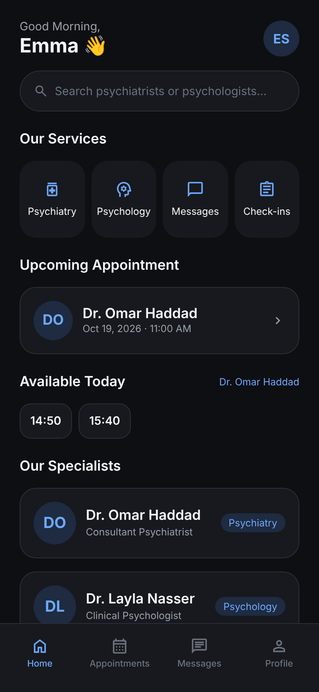

# New Chester Clinic

Online psychiatry and psychology clinic: one Expo app (iOS, Android, web) on Supabase. Patients and staff sign in on the same screen; staff get bilingual (English / Arabic) practitioner screens.

See [docs/PLAN.md](docs/PLAN.md) for the full plan, data model, open decisions and the Supabase setup steps.



## Layout

```
apps/clinic       The app: patient screens in src/app/(tabs), staff screens in src/app/staff
packages/shared   Row types, theme, slot calculation, questionnaire scoring
supabase          Database migration (tables, access rules, functions), seed data, access tests
```

## Run it

Requires Node 22 and a Supabase project with the migration and seed applied (see "Setting up the Supabase project" in [docs/PLAN.md](docs/PLAN.md)).

```bash
npm install

# Put the project URL and publishable key in this file
cp apps/clinic/.env.example apps/clinic/.env.local

npm run app         # scan the QR code with Expo Go, or press w for web
npm run web         # web only, http://localhost:8081
```

## Checks

```bash
npm run typecheck   # all packages
npm run test:db     # access rules and database functions, on an in-process Postgres
npm run seed:sql    # regenerate supabase/seed.sql after changing the questionnaires
```
